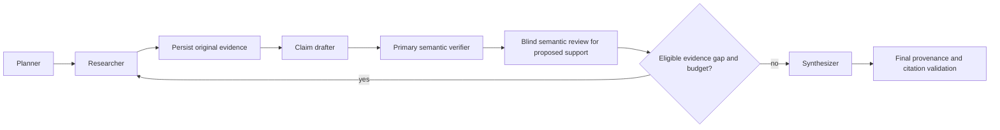

# ProofTrail

An evidence-grounded research analyst by [Nishant Sorathiya](https://github.com/nishantsorathiya-rgb),
built for the DeepDive track of Agent Arena 2026.

ProofTrail plans research, retrieves original web evidence, drafts atomic claims,
checks them against exact source passages and produces a cited report with an
auditable decision trail. All runtime model calls use Mesh API. Tavily provides
search and extraction, with generated search answers disabled.

## Architecture

ProofTrail is a modular monolith built with **FastAPI, LangGraph, SQLAlchemy,
SQLite and Alembic**. Typed domain and application ports keep provider adapters
separate from research logic. It supports **Python 3.11 and 3.12**.



Planner, Researcher, Verifier and Synthesizer have distinct responsibilities.
The drafter creates unverified candidates from retrieved passages. Insufficient
evidence can trigger bounded corrective research when retry and request budgets
permit. See the [architecture decisions](docs/adr/0001-foundation.md).

## Evidence and verification

- Search snippets are discovery clues. Supporting evidence must come from a
  successfully extracted original source.
- Source text, original URLs, retrieval timestamps, hashes, passage IDs and
  quotation offsets are persisted in SQLite.
- `exact_quotes_v2` resolves an exact quotation inside an approved passage.
  Missing or ambiguous quotations, incorrect legacy coordinates and changed
  provenance are rejected.
- A quotation match alone cannot approve a claim. Primary semantic verification
  evaluates support, and proposed positive findings require a separate blind
  review and an evidence-bound verification receipt.
- Synthesis organizes validated supported claims. Final validation checks their
  citations and provenance again. Rejected claims and operational failures cannot
  become supported findings through a fallback.

Request budgets, concurrency limits, timeouts, source validation and audit events
remain enforced throughout the workflow. The two semantic reviews use the same
configured model and can share errors; neither is a guarantee of factual accuracy.

## Install and run locally

Use a single process/worker, loopback binding and SQLite. From the repository in
Windows PowerShell:

```powershell
py -3.12 -m venv .venv
& .\.venv\Scripts\python.exe -m pip install -c requirements.lock -e '.[dev]'
Copy-Item .env.example .env
& .\.venv\Scripts\python.exe -m alembic upgrade head
& .\.venv\Scripts\python.exe -m uvicorn app.main:app --host 127.0.0.1 --port 8000 --no-access-log
```

Use `py -3.11` for the other supported interpreter. The lock file is a tested
Windows pip constraint set, not a hashed cross-platform lock. The database schema
is at Alembic revision **0005**.

Keep `ENABLE_LIVE_REQUESTS=false` for offline validation. Health checks and offline
tests require no API credentials. Research in offline server mode reports the
unavailable providers rather than fabricating evidence.

For live research, configure Mesh and Tavily credentials privately using the
existing masked configuration scripts and check provider credits and request
budgets before enabling requests. Never commit credentials or `.env` files.
This local application has no user authentication; do not expose it publicly or
run multiple Uvicorn workers with its single-process coordinator.

## Validation

The release contains **423 automated tests**, passed on Python 3.11 and 3.12.
Run the checks locally:

```powershell
& .\.venv\Scripts\python.exe -m pytest -q
& .\.venv\Scripts\python.exe -m compileall app
& .\.venv\Scripts\python.exe -m ruff check .
& .\.venv\Scripts\python.exe -m pip check
& .\.venv\Scripts\python.exe -m alembic check
```

Passing tests demonstrate the exercised software behavior, not general semantic
accuracy. [Public release validation](results/public_release_validation_001.json)
preserves the measured results, including earlier failed projection attempts.

## API

| Route | Purpose |
| --- | --- |
| GET /health | Local application/database health; no provider call |
| POST /research | Queue one question and return 202/run_id |
| GET /research/{id} | Plan, stage state, budgets and errors |
| GET /research/{id}/evidence | Exact persisted source material |
| GET /research/{id}/claims | Candidate and verification history |
| GET /research/{id}/retries | Corrective research history |
| GET /research/{id}/audit | Ordered decision trail |
| GET /research/{id}/report | Integrity-revalidated final report |

## Evaluation and limitations

The evaluation dataset contains **60 synthetic, unreviewed cases**: 20 proposed
labels per class, split into 36 development and 24 held-out cases. Review fields
remain unapproved. **Human-reviewed accuracy and live corpus accuracy are N/A.**
Assisted assessment of development examples is not independent human ground
truth. The held-out set is preserved separately from development and tuning.

Run development evaluation with `python -m scripts.evaluate_p6`. Use new output
paths to preserve earlier results. The offline controlled fixtures exercise the
verification interface; their scores do not measure Mesh semantic accuracy.
Metrics distinguish operational failures, structural citation validity, semantic
support and coverage. See [evaluation methodology](docs/evaluation_methodology.md)
and the [review worksheet instructions](docs/evaluation_owner_review.md).

Five saved synthetic benchmark pairs compare Basic Research and ProofTrail with
the same initial evidence. Added verification/retry costs and incomplete coverage
are reported. These results do not establish real-world superiority. See the
[benchmark methodology](docs/p7_benchmark_methodology.md) and `results/p7_runs/`.

One genuine live end-to-end integration example has been completed. Its detailed
evidence, report and audit are retained privately. One successful example does
not establish general semantic accuracy or live retry effectiveness. The public
quotation regression excerpt preserves source and claim relationships; it is not
a complete historical live journal.

## GitHub Actions and competition checks

The original organizer workflow runs on push, uses GitHub OIDC, downloads protected
checks and reports results to the competition service. Its required repository
secrets are `SUBMISSION_TOKEN` and a dedicated `MESH_API_KEY`. Enter their values
privately in GitHub Actions secrets.

A submitted competition entry is required before the organizer can record check
results. Review provider quota and spending limits before triggering checks;
their request behavior is controlled by the protected organizer script. See
[CI setup and budget considerations](docs/organizer_ci_readiness_001.md).

The separate manual offline-validation workflow tests the application without
provider secrets. It does not replace the organizer's competition checks.
Current rules, deadlines and submission requirements are maintained on the
[official competition page](https://career.krishnaik.in/hackathons/agent-arena-2026).

## Project provenance and rights

ProofTrail is independently directed and maintained by Nishant Sorathiya.
Development used AI coding assistance under the project owner's direction;
provenance details are recorded in [third-party notices](THIRD_PARTY_NOTICES.md).

Original material remains **All Rights Reserved to the extent of rights held**.
Third-party documentation retains its applicable licenses and attribution. See
[LICENSE](LICENSE), [Python documentation notices](LICENSES/Python-documentation-NOTICE.md)
and the [public release scope](docs/public_release_projection_001.md).
