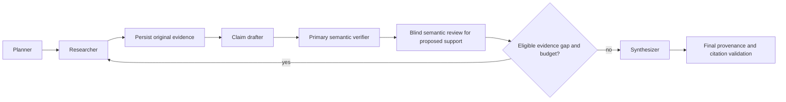

# ProofTrail

ProofTrail is an independent DeepDive project for Agent Arena 2026. It plans
research, retrieves original web evidence, drafts atomic claims, verifies them
against exact persisted passages and produces a cited report. Runtime model calls
use Mesh API exclusively. Tavily supplies retrieval; generated search answers are
disabled. The implementation was assisted by Codex.

This public proposal contains the complete application, scripts and unchanged
423-test suite. It excludes optional live-provider journals and performance data.
It is not yet published or cleared as competition eligible. Original materials
remain All Rights Reserved only to the extent of rights held; third-party terms
remain separate. See [rights notices](THIRD_PARTY_NOTICES.md) and
[publication scope](docs/public_release_projection_001.md).

## Install and validate

Python **3.11 or 3.12** is supported. Use one process/worker, loopback binding and
SQLite. From this repository in PowerShell:

```powershell
py -3.12 -m venv .venv
& .\.venv\Scripts\python.exe -m pip install -c requirements.lock -e '.[dev]'
Copy-Item .env.example .env
& .\.venv\Scripts\python.exe -m pytest -q
& .\.venv\Scripts\python.exe -m compileall app
& .\.venv\Scripts\python.exe -m ruff check .
& .\.venv\Scripts\python.exe -m pip check
& .\.venv\Scripts\python.exe -m alembic upgrade head
& .\.venv\Scripts\python.exe -m alembic check
& .\.venv\Scripts\python.exe -m uvicorn app.main:app --host 127.0.0.1 --port 8000 --no-access-log
```

Use `py -3.11` to select the other supported interpreter. The lock is a tested
Windows pip constraint set, not a hashed cross-platform lock. Database revision
is 0005. Do not run multiple Uvicorn workers with the local coordinator. This local
application has no user authentication; do not expose it publicly.

Keep `ENABLE_LIVE_REQUESTS=false`. Health and offline tests need no credentials.
Research in offline server mode fails honestly rather than returning fabricated
evidence. Private Mesh/Tavily keys belong only in ignored local configuration.
The existing configure scripts offer masked interactive key entry; no credential
belongs in Git or chat. Every real request requires a separately approved budget.

## Research workflow



The modular monolith uses FastAPI, typed domain/application ports, LangGraph,
SQLAlchemy, SQLite and Alembic. Infrastructure implements the ports. Planner,
Researcher, Verifier and Synthesizer are distinct executing roles; the drafter
produces immutable unverified candidates from retrieved passages. See the
[architecture decisions](docs/adr/0001-foundation.md).

Search snippets cannot certify a claim. Original extracted source text, URLs,
retrieval timestamps, hashes, passage IDs and exact offsets are persisted.
`exact_quotes_v2` resolves a model-selected exact quotation within an approved
passage. Ambiguous/missing text and provenance changes fail closed. Legacy wrong
coordinates remain rejected. Semantic entailment requires an actual model judgment;
positive findings additionally require a separate blind review and evidence-bound
receipt. A valid quotation alone does not prove support. Synthesis can organize
only the validated supported set and cannot introduce new factual prose.

Persistent request budgets, concurrency/time/text bounds, retry eligibility,
source validation and audit logging remain enforced. Rejected or operationally
failed claims cannot fall back to SUPPORTED. Same-model primary/blind review can
share errors; this is a safeguard, not a general accuracy guarantee.

## API

| Route | Purpose |
| --- | --- |
| GET /health | Local application/database health, no provider call |
| POST /research | Queue one question and return 202/run_id |
| GET /research/{id} | Plan, stage state, budget and errors |
| GET /research/{id}/evidence | Exact persisted untrusted source material |
| GET /research/{id}/claims | Candidate and verification history |
| GET /research/{id}/retries | Bounded corrective research history |
| GET /research/{id}/audit | Ordered decision trail |
| GET /research/{id}/report | Integrity-revalidated final report |

## Evaluation and evidence limits

The 60 supplied cases are explicitly synthetic, split into 36 development and
24 held-out cases with 20 proposed labels per class overall. All owner-review
fields remain unapproved. Human-reviewed accuracy and live corpus accuracy are
**N/A**. An AI-assisted review of development examples is not human ground truth.
The held-out set is preserved and must not be used for development tuning.

Reproduce development evaluation with `python -m scripts.evaluate_p6`; use new
output paths if preserving existing results. Historical P6 results use an offline
controlled fixture, not Mesh semantic reasoning. Metrics distinguish operational
failures, structural citations, semantic support and coverage. See
[methodology](docs/evaluation_methodology.md) and
[owner review](docs/evaluation_owner_review.md).

Five preserved P7 synthetic pairs compare Basic Research and ProofTrail on equal
initial evidence. Extra verification/retry costs and incomplete coverage remain
visible. Scripted fixture scores do not establish real-world superiority.
Raw results are in `results/p7_runs/`; see
[benchmark methodology](docs/p7_benchmark_methodology.md).

The owner has accepted one genuine B002 end-to-end example. Its private evidence,
report and audit are preserved separately; no B002 demo or live-service performance
telemetry is included here. One success does not establish general semantic
accuracy or live conditional-retry effectiveness. The B001 quotation regression
excerpt preserves source/claim/quote semantics but is not a complete historical run.

## Release and organizer CI

The original organizer workflow is byte-identical and triggers on push. It uses
GitHub OIDC, SUBMISSION_TOKEN and a dedicated MESH_API_KEY, downloads protected
checks and reports externally. Its current request envelope is not independently
verified. A public push is not a guaranteed free/offline action. See
[CI approval requirements](docs/organizer_ci_readiness_001.md).

The manual offline workflow is separate and does not substitute for organizer
critical checks. No commit, push, CI execution, deployment or submission is approved
by these files. A deployed URL was optional in the observed form; GitHub, demo and
participation fields must be checked against the current owner dashboard.

Owner target: **Sunday 25 October 2026 before 6 PM IST**. The separately observed
organizer deadline is 30 October 2026, 11 PM IST. Applicable entry licensing/IP and
AI-disclosure terms remain an owner clarification before publication/submission.
